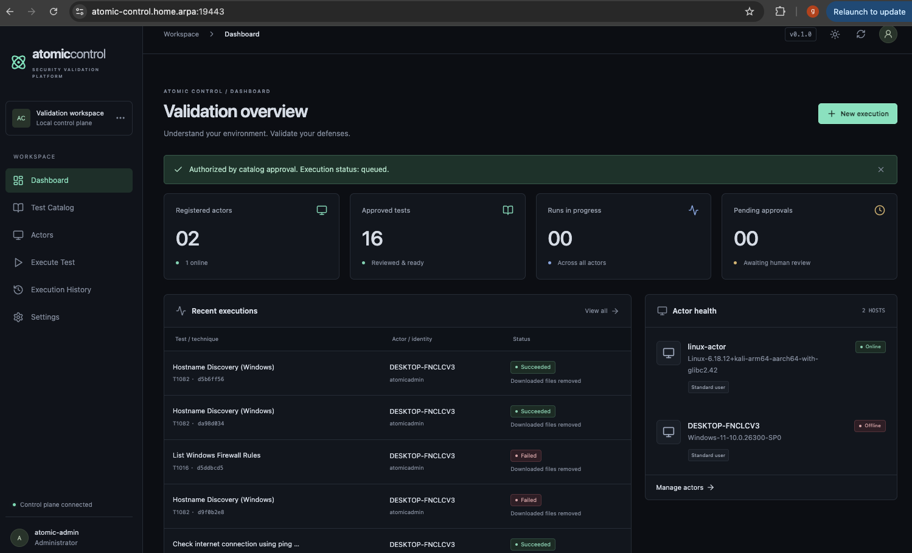
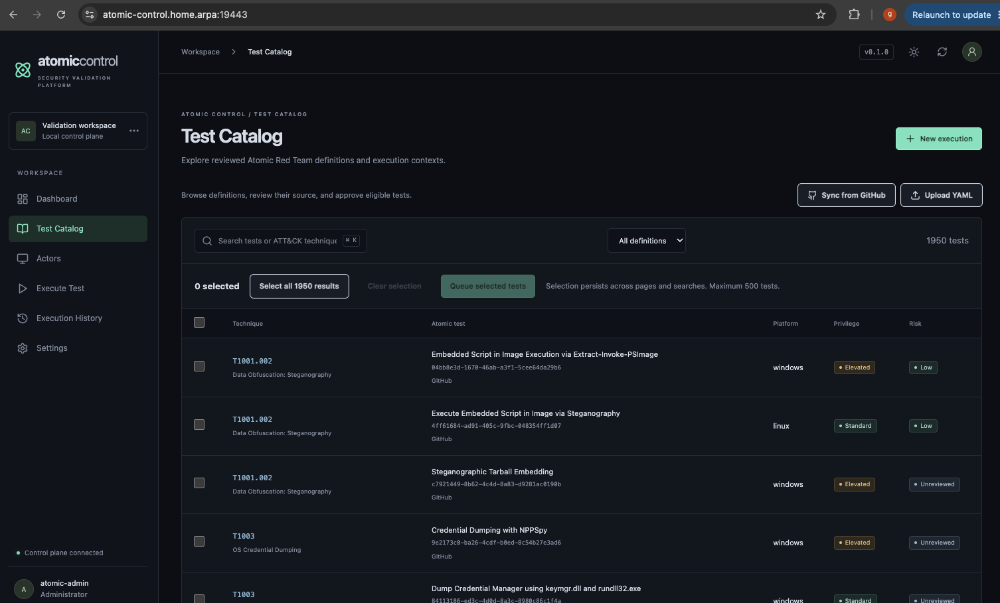
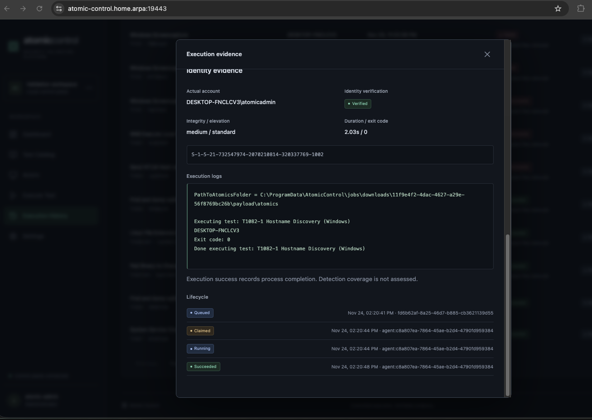
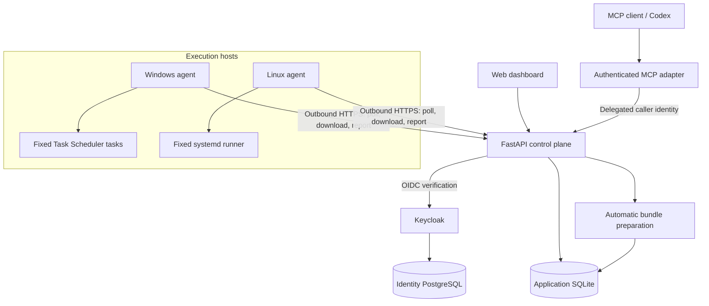

# Atomic Control

**A security validation platform for Windows and Linux.**

Atomic Control is a security validation platform for managing, executing and reviewing [Atomic Red Team](https://github.com/redcanaryco/atomic-red-team) tests across Windows and Linux. It combines a web dashboard, custom tests, execution queues, verified identities and detailed evidence with REST API and MCP integrations.

[Installation guide](docs/INSTALLATION_GUIDE.md) · [User guide](docs/SYSTEM_GUIDE.md) · [Architecture](docs/ARCHITECTURE.md) · [API](docs/API.md) · [All documentation](docs/README.md)



The dashboard brings host health, approved tests and recent results into one workspace. Screenshots show an example deployment; counts, hostnames and results reflect that environment.

## Features

| Capability                   | What it provides                                                                                                                                               |
| ---------------------------- | -------------------------------------------------------------------------------------------------------------------------------------------------------------- |
| **Atomic test catalog**      | Sync the official GitHub repository or upload YAML, search ATT&CK techniques, inspect commands/defaults/cleanup and approve intended tests.                    |
| **Custom tests**             | Submit new Atomic YAML and supporting files through REST or MCP. Content revisions require no GitHub commit; submissions remain unapproved until human review. |
| **Windows and Linux agents** | Generate host-specific installation packages, enroll over HTTPS, manage local execution profiles and monitor identity validation.                              |
| **Single runs and queues**   | Run one test or queue up to 500 selected tests on one actor/profile. Preview eligibility, preserve order, and pause, resume or cancel remaining work.          |
| **On-demand delivery**       | Automatically prepare and deliver only the current test and its declared files. Verify the bundle and remove attempt files afterward.                          |
| **Execution evidence**       | Inspect the actual account, privilege, identity checks, exit status, logs, lifecycle and downloaded-file removal. Request test cleanup separately.             |
| **SSO and administration**   | Keycloak/OIDC login, role-based access, a login-only unauthenticated screen, 24-hour default sessions, user management and configurable enrollment lifetime.   |
| **REST and MCP access**      | Use the platform from the dashboard, API or an MCP client such as Codex, with caller identity preserved.                                                       |

## Browse, review and select tests

The catalog combines technique search, platform/privilege information, risk classification and selection for queued execution. GitHub imports resolve an exact commit. Custom submissions receive an immutable content revision. Importing or submitting a definition does not approve it or execute it.



An administrator approves the definition and supporting files for the intended profile types. In the default catalog approval mode, operators can then request compatible approved tests without a separate approval for every run. Optional per-run approval adds scoped grants and an additional human decision.

See [catalog imports](docs/CATALOG_IMPORTS.md), [custom tests](docs/CUSTOM_TESTS.md) and [execution setup](docs/EXECUTION_SETUP.md).

## How execution works

1. **Choose approved content.** Select an exact test definition or an ordered set of tests.
2. **Choose a host and identity.** Match the test platform to an online actor and healthy local execution profile.
3. **Prepare automatically.** The control plane builds or reuses the approved bundle when the request reaches the actor's queue head.
4. **Verify and execute.** The agent polls over HTTPS, validates signed grants and file hashes, and verifies its actual local identity before execution.
5. **Collect evidence and remove files.** The agent reports bounded results and removes downloaded attempt files after processes stop.
6. **Perform test cleanup when needed.** Cleanup is a separate authorized action using the original retained bundle.

Only one attempt runs at a time on an actor. Queues continue after ordinary failures by default, with a selectable pause policy. Uncertain outcomes hold the actor for investigation and reconciliation; execution is never automatically replayed.

## Inspect the evidence

Execution details connect the requested behavior to the observed account, privilege, exit code, output and lifecycle. Workspace removal is tracked separately from the test's effects on the host.



A successful exit records execution completion. Detection coverage is assessed by comparing this evidence with your security telemetry. Removing downloaded test files does not reverse host changes; use the test's cleanup action where required.

## Architecture at a glance



| Layer                    | Responsibility                                                                                                                                                                       |
| ------------------------ | ------------------------------------------------------------------------------------------------------------------------------------------------------------------------------------ |
| **Management host**      | A macOS or Linux host runs the API, built React dashboard, packaging worker and MCP adapter. Docker runs the bundled Keycloak and its identity database.                             |
| **Control plane**        | Owns catalog review, authorization, durable queues, signed file delivery, immutable run snapshots, evidence and audit in the application database.                                   |
| **Windows execution**    | A LocalSystem agent dispatches fixed password-backed scheduled tasks under verified standard-user or elevated profiles. Setup installs Invoke-AtomicRedTeam and its YAML dependency. |
| **Linux execution**      | A root broker dispatches the fixed runner under registered UID/GID profiles through systemd, with cgroup process tracking.                                                           |
| **Network and identity** | Agents initiate HTTPS connections to the API. Human SSO, rotating agent credentials and signed job grants serve separate purposes. MCP delegates the actual caller's identity.       |

The bundled deployment uses HTTPS port **19443** for the dashboard/API, **18443** for Keycloak and loopback **19444** for MCP. Agents can be distributed across routed internal networks when routing, DNS, certificate trust and firewall/subnet rules permit access. The job transport requires no inbound remote-shell port on the actors.

On-demand delivery is the default and needs no full host catalog checkout or Git installation. A protected pinned-checkout mode is also available. See the [full architecture](docs/ARCHITECTURE.md), [delivery workflow](docs/ON_DEMAND_TEST_DELIVERY.md) and [security model](docs/SECURITY.md).

## Work from chat or the API

The [Atomic Control Codex plugin](docs/CODEX_PLUGIN.md) connects chat to authenticated MCP. It supports approved-test and actor discovery, custom-test submission, execution/check/cleanup requests, queue controls and evidence lookup.

Example requests:

- “List approved system-information discovery tests and available Windows actors.”
- “Submit this custom Atomic YAML for review.”
- “Queue these approved tests on the selected Linux actor.”
- “Inspect the last run and explain its identity evidence and output.”

Custom YAML enters through **`POST /api/v1/catalog/custom-tests`** or **`atomic_add_custom_test`**. Submissions require stable idempotency keys and new GUIDs, and cannot overwrite existing definitions. Human approval stays in Test Catalog. See [custom-test examples](docs/CUSTOM_TESTS.md), [REST contracts](docs/API.md) and [MCP tools and scopes](docs/MCP.md).

## Get started

Follow the [installation guide](docs/INSTALLATION_GUIDE.md) to configure a management host, canonical DNS names, trusted HTTPS and SSO. Then use the [user guide](docs/SYSTEM_GUIDE.md) to import tests, enroll actors, provision identities and request execution.

| Environment     | Requirements                                                                                                       |
| --------------- | ------------------------------------------------------------------------------------------------------------------ |
| Management host | macOS or Linux, Python 3.12+, Node.js 22.12+, pnpm and Docker for bundled identity services                        |
| Windows actor   | Protected all-users Python 3.12+, Windows PowerShell 5.1, local execution accounts and password-backed fixed tasks |
| Linux actor     | Python 3.12+, systemd 245+, unified cgroup v2 and bash/sh                                                          |

Initial agent tokens default to **60 minutes**, configurable from **5 to 1,440 minutes** in administrator Settings. Profile metadata synchronizes automatically; local accounts, Windows batch-logon rights and test-specific external prerequisites remain host provisioning responsibilities.

Use authorized execution hosts with appropriate recovery arrangements. The Windows runner uses noninteractive batch tasks; tests requiring an interactive desktop are outside that execution model.

## Documentation and development

- [Installation and deployment](docs/INSTALLATION_GUIDE.md)
- [Everyday use and administration](docs/SYSTEM_GUIDE.md)
- [Windows agent packages](docs/AGENT_PACKAGES.md) and [Linux agent setup](docs/LINUX_AGENT.md)
- [Architecture](docs/ARCHITECTURE.md) and [implemented specification](docs/SPECIFICATION.md)
- [Operations, backups and recovery](docs/OPERATIONS.md)
- [Security boundaries](docs/SECURITY.md) and [validation](docs/VALIDATION.md)
- [Complete documentation index](docs/README.md)

For development checks:

```sh
.venv/bin/ruff check apps scripts tests
.venv/bin/ruff format --check apps scripts tests
.venv/bin/mypy apps scripts
.venv/bin/pytest tests/unit tests/integration -q
pnpm --dir apps/frontend build
pnpm --dir apps/frontend test
```

Automated fixtures use isolated data and synthetic evidence. Native Windows/Linux installation, identity, containment and recovery behavior require platform acceptance on the intended hosts.
