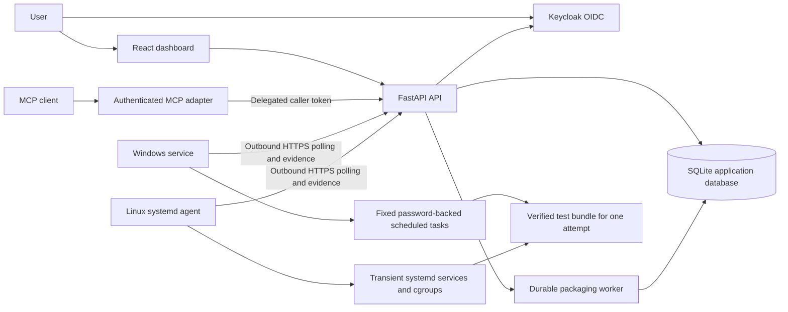

# Architecture

Atomic Control runs reviewed Atomic Red Team tests on enrolled Windows and Linux hosts. The control plane owns catalog approval, authorization, queues, file delivery, execution records and audit. Agents make outbound HTTPS requests and execute through fixed local brokers. React and MCP use the REST API; neither connects directly to an execution host.

## Components and deployment

| Component           | Implementation                     | Responsibility                                                                         |
| ------------------- | ---------------------------------- | -------------------------------------------------------------------------------------- |
| Dashboard           | `apps/frontend`                    | Login, catalog review, actors/profiles, execution, queues, evidence and administration |
| REST API            | `apps/api/app`                     | OIDC, roles, approvals, immutable requests, scheduling and agent contracts             |
| Packaging worker    | `apps/api/app/jobs/preparation.py` | Build and cache approved bundles without executing their commands                      |
| MCP adapter         | `apps/mcp`                         | Caller-preserving discovery and authorized execution/check/cleanup/queue requests      |
| Windows agent       | `apps/agent`                       | LocalSystem transport/broker, Task Scheduler dispatch and token verification           |
| Linux agent         | `apps/agent/linux`                 | Root transport/broker, fixed UID/GID execution through systemd                         |
| Identity deployment | `apps/local_identity`              | Keycloak/PostgreSQL containers, HTTPS configuration and application launcher           |

The bundled deployment runs Keycloak and its PostgreSQL database in Docker. The API, built dashboard and MCP run on a macOS or Linux management host. Atomic Control uses a separate SQLite database through SQLAlchemy/Alembic. PostgreSQL application-database deployment requires separate driver and acceptance validation.

The HTTPS API/dashboard listens on port 19443, Keycloak on 18443 and MCP on loopback port 19444. Hostnames identify the public API and OIDC issuer; bind addresses, subnet filtering, DNS, certificates and firewalls determine network reachability. Routed actors require outbound access to the API, with no inbound agent management port. Use one API worker because pending OAuth login and execution-access previews are process-local.

## Catalog and approval

Administrators import the official GitHub catalog at an exact commit or upload bounded YAML. Preview and confirmation are separate transactional steps. Importing records definitions; it grants no execution approval and installs no host files. Unsupported platforms can be browsed but cannot execute.

Catalog approval binds the test GUID, normalized definition hash, source revision, risk, supported platforms and allowed profile types. Supporting files are resolved into an immutable file plan: official assets come from the exact official commit; custom assets are uploaded and retained centrally. Definitions without supporting-file references can be packaged directly under their existing exact catalog approval. Changed or revoked definitions cannot dispatch under an earlier review.

`catalog/serialization.py` renders the selected definition as one technique YAML. It omits an empty optional `input_arguments` mapping so Invoke-AtomicRedTeam accepts tests without inputs. It preserves commands, input defaults and the normalized reviewed definition. Re-approval compares the generated YAML hash before reusing a cached plan; a changed representation receives a new plan. Existing plans and run bindings retain their original bytes.

Default `ATOMIC_APPROVAL_MODE=catalog` treats catalog approval as standing authorization for compatible operator requests. Optional `per_run` mode also requires exact subject/actor/profile/test/risk/action grants and separate human approval. Elevated per-run approval requires a privileged approver different from the requester. Execution-access grants are managed through the administrator API.

Operators and MCP callers can also [submit custom YAML](CUSTOM_TESTS.md) and supporting files through an append-only API. New GUIDs enter the catalog unapproved. A content-derived protocol-compatible revision binds the submission without claiming a GitHub commit; its full definition/file hashes remain approval-bound. Custom revisions use on-demand delivery and are excluded from host Git-checkout options. Durable caller/key receipts prevent duplicate creation.

## Execution and file delivery

1. An operator requests one approved test or submits an eligibility-previewed batch for one actor/profile. Requests are idempotent and capture an immutable snapshot and hash. Execution reasons are optional.
2. The actor's FIFO head waits for authorization and readiness. Central preparation builds or reuses the signed bundle for its approved plan. This stage takes no actor execution lease.
3. A separate immutable execution binding joins the original request/approval snapshot to the exact packaged artifact. Packaging does not rewrite the approved snapshot.
4. The agent claims one attempt with an actor-scoped lease and unpredictable fence. It verifies an RS256 preparation grant, downloads through the API, verifies the bundle and protects the attempt workspace.
5. The agent reports readiness. The API rechecks authorization and issues an execution grant. A preparation/download grant cannot authorize local execution.
6. The fixed local runner checks its actual identity, grant, profile and selected definition, then performs `execute`, prerequisite `check`, or `cleanup` with approved defaults.
7. The agent confirms processes have stopped, removes attempt payload/output files, acknowledges workspace removal and submits bounded evidence. The server retains a hold when removal or execution state is uncertain.

On-demand delivery is the default. Actors receive only the current test and declared supporting files; they need no full catalog checkout or Git. Each job pins its own revision, so one queue can contain tests from different commits. Test cleanup is a separate authorized run using the original retained bundle. Removing downloaded files does not reverse host changes made by the test.

**Pinned checkout** is also a supported selectable delivery mode. Those actors execute from a protected clean checkout whose revision and definition hashes match approval. Linux exposes managed catalog installation from actor details; Windows checkout installation is available through its package installer. This mode's Git/catalog requirements do not apply to on-demand actors.

## Queues and recovery

Single requests and batches share one durable FIFO per actor. A batch supports up to 500 selected tests and one profile, with ordered eligibility/exclusion preview. The default failure policy continues after ordinary failures; pause-for-review is selectable. Identity, authorization and integrity failures or uncertain outcomes hold dispatch. Pause and cancel-remaining leave the active item to finish; active execution cancellation is separate. Queue lifetime defaults to 24 hours.

Only one actor attempt can hold its lease. Renewals, workspace receipts and results bind actor, attempt and fence. Identical result repeats are accepted; conflicting or stale results are rejected. Central packaging and pre-execution transfers have bounded retries. Execution is never automatically replayed.

An expired execution lease becomes inconclusive and retains its actor lock. Agents retain protected journals and buffered evidence across restarts. Administrators verify host processes and files before recording reconciliation. Reconciliation preserves the unknown outcome and schedules no retry. A failed central preparation can receive a new idempotent retry request only if no actor attempt started.

## Profiles and local execution

Profile IDs and account/identity bindings are immutable. Administrators register and delete profiles in actor details. Agents fetch signed, actor-bound profile generations while idle, apply metadata and report identity-probe results automatically. Active leases or uncertain local state defer synchronization. Registration creates no local account or permission grant. Healthy profiles can be selected independently of another profile's validation failure; a configuration-application failure blocks dispatch.

Windows uses a protected all-users Python, a LocalSystem broker, and fixed execution/identity Task Scheduler tasks. Existing local account passwords are entered only on the Windows host. Standard profiles require a non-administrator SID and medium integrity; elevated profiles require their exact SID, an enabled administrator token and high integrity. Tasks need batch-logon rights. The child rechecks its token and imports the hash-pinned Invoke-AtomicRedTeam module. A per-attempt Windows Job Object provides process containment; an unverifiable containment state keeps the actor held.

The Windows installer verifies HTTPS/CA trust, installs the pinned framework and its YAML dependency, records its module hash, enrolls, and registers the service. `-StartService` starts it after successful setup. The wrapper supplies platform variables for Windows PowerShell 5.1 before module import while retaining strict mode and identity/hash checks.

Linux requires systemd 245+, unified cgroup v2, Python 3.12+ and bash/sh. Its root broker starts a fixed runner under the registered UID/GID. Standard profiles require non-root identity, no root group/capabilities and NoNewPrivileges; elevated profiles require root UID/GID. The broker checks cgroup process termination. The installer leaves `atomic-control-agent` disabled and stopped until explicitly enabled.

Automatic installation covers the Windows execution framework, not per-test prerequisites. Prerequisite checks execute reviewed check commands; they never invoke prerequisite installation commands. Domain, interactive and S4U execution profiles are unsupported.

## Authentication and administration

People use OIDC access tokens. Browser sign-in uses authorization code/PKCE, state and nonce. The API stores encrypted access/refresh tokens and a hashed opaque browser session identifier. The browser receives a Secure, HttpOnly, SameSite=Strict cookie. Session lifetime defaults to a fixed 24 hours; token refresh and activity do not extend the deadline. Dashboard components mount only after authorization and are cleared on logout/authorization loss. Identity labels use the verified username; immutable subjects identify permissions and audit records.

MCP verifies the resource token, exchanges it for an API-audience token preserving the caller, and invokes REST. It has read/request/cleanup scopes and no catalog approval, actor/user administration or reconciliation tools. There is no shared administrator identity for chat.

Agents use single-use, actor/hostname/platform-bound enrollment tokens followed by their own rotating opaque machine credentials. The default initial token lifetime is 60 minutes; administrator Settings persists a 5–1,440-minute value for future issuance. Windows protects credentials with DPAPI and ACLs; Linux uses root-only files. The API stores credential digests. Agents pin the job-signing public key. Agent token `iat` is backdated five seconds; expiration, approval and lease deadlines are unchanged.

Administrator Settings manages Keycloak human users, application roles, user deletion and enrollment lifetime. The management client stays server-side. Role changes/deletion revoke local access and retain durable holds if provider completion is uncertain. User passwords are not an application credential store. Password resets and service accounts are managed in Keycloak.

Actor deletion permanently removes registration, profiles, credentials and enrollment state, cancels waiting work and releases the hostname. Active leases, applying configuration/catalog operations and unresolved execution block deletion. Run snapshots, results and audit remain attached to original IDs. Profile deletion likewise preserves history and leaves local accounts/files intact. Agents synchronize profile removal; Windows removes verified fixed tasks. Host uninstallation is a separate local operation.

## Persistence and limits

SQLite uses foreign keys, WAL, busy timeout and serialized write transactions. Durable tables cover actors, profiles, credentials, enrollment settings/tokens, catalog revisions/definitions/reviews and custom-submission receipts, file plans/source blobs/artifacts, packaging builds, execution bindings, runs/batches/attempts/approvals/leases, events/logs/audit, browser sessions and user-access holds. Configuration/key files are protected separately.

Bundles are bounded to 128 regular files, 16 MiB per file and 64 MiB overall. Central packaging and actor preparation each default to 300 seconds; execution timeout is separate. Artifact bytes remain in the database for evidence and historical cleanup, without automatic artifact garbage collection. Backups must include application data, identity volumes and required private keys.

The system is one trusted workspace. Host administrators and execution hosts are trusted; evidence is not tamper-proof attestation. Result success describes execution evidence, not security-product detection. See [security boundaries](SECURITY.md), [platform validation](VALIDATION.md), [API contracts](API.md) and [operations](OPERATIONS.md).
