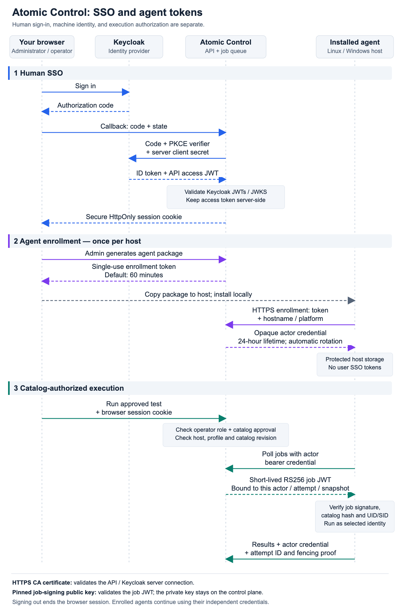

# Atomic Control user guide

Use this guide for everyday dashboard tasks. For a new control plane, start with the [installation guide](INSTALLATION_GUIDE.md).

The usual workflow is: **import and approve tests → enroll a host → validate its profiles → run or queue approved tests**. The default catalog approval mode needs no extra permission grant or approval for each run.

## Sign in and navigate

Open your configured dashboard URL and choose **Sign in with SSO**. The dashboard stays hidden until you are authorized. Your username appears in the sidebar, user menu and Settings.

Select the **top-right user icon → Sign out** from any page. **Settings → Sign out** also works. Sessions last up to 24 hours; activity does not extend that deadline. Short-lived tokens refresh automatically, and application restarts retain valid sessions.

| Page              | Use it to                                                                                               |
| ----------------- | ------------------------------------------------------------------------------------------------------- |
| Dashboard         | See host availability and recent activity                                                               |
| Test Catalog      | Find tests, import definitions, review them and select a batch                                          |
| Actors            | Add hosts, download agents, manage profiles and view queues                                             |
| Execute Test      | Run one approved test or check its prerequisites                                                        |
| Execution History | Inspect results, identity evidence, output, cleanup and cancellation                                    |
| Approvals         | Review per-run requests when that mode is enabled                                                       |
| Settings          | See your username/roles and audit events; admins also manage users and the initial agent token lifetime |

| Access level  | Permissions                                                         |
| ------------- | ------------------------------------------------------------------- |
| Viewer        | Read catalog, hosts and evidence                                    |
| Operator      | Viewer access plus execution, queue, check and cleanup requests     |
| Approver      | Viewer access plus per-run and privileged approvals                 |
| Administrator | All application roles, including catalog, actor and user management |

## Import and approve tests

As an administrator:

1. Open **Test Catalog → Sync from GitHub**. Enter a branch, tag or commit and choose **Fetch preview**.
2. Review added, changed and removed definitions and the resolved commit. Confirm the reviewed import.
3. Open an intended test. Under **Administrator review**, inspect its commands, prerequisites, cleanup and defaults, select allowed profile types and a risk level, then choose **Approve test**.

Importing does not approve tests or install them on hosts. Changed definitions/revisions need a new review. Approval covers the exact definition and permitted identity types; operators can then request it on compatible prepared actors.

For YAML, choose **Upload YAML**, select technique files, validate the preview and confirm the import. Supply the exact source commit for executable definitions. Without it, the upload is catalog-only. For on-demand delivery, upload custom supporting files and approve the resulting bundle; actors receive it only for their attempt. Pinned-checkout actors require matching protected local content. See [catalog import details](CATALOG_IMPORTS.md).

## Add an actor

An **actor** is a registered execution host. Its **execution profile** identifies the local account under which a test runs.

Initial installation packages contain a single-use enrollment token that expires **60 minutes after generation by default**. Install before the expiry shown after download. The same lifetime applies to Linux and Windows packages. To allow more installation time, [change the enrollment setting](#configure-the-initial-agent-token-lifetime) before generating the ZIP.

### Linux

1. On the host, run `hostname` and `id ACCOUNT_NAME` for your intended existing execution account.
2. Open **Actors → Add actor**, select **Linux (systemd)**, enter the exact hostname and choose **Register and configure download**.
3. Open actor details and choose **Add execution profile**. Register the standard user's actual account and numeric UID. Register account `root`, UID `0`, only if elevated tests are needed.
4. Choose **Generate agent**, keep the reachable hostname-based HTTPS API URL, include enrollment for a first installation, and download the ZIP.
5. Transfer the ZIP and public CA certificate to that host. Verify the displayed ZIP checksum, trust the CA, and extract the package privately.

From the extracted `AtomicControlAgent` directory:

```sh
sudo /usr/bin/python3 -I install.py --check-only
sudo /usr/bin/python3 -I install.py
sudo systemctl enable --now atomic-control-agent
sudo systemctl status atomic-control-agent --no-pager -l
```

Use a Python 3.12+ executable. Linux also needs bash/sh, systemd 245+ and unified cgroup v2. Git is required only for selectable pinned-checkout mode. The installer leaves the service stopped; the explicit start command enables its heartbeat.

Expect the actor to become **Online** and **Execution identity** to show **Ready**. Validation runs automatically; administrators see **Retry validation** only when an identity needs attention. Registering a profile does not create the local account or grant sudo rights. Current agents apply and validate profile additions while idle; reenrollment is unnecessary. Runtime maintenance uses **Download agent update**. See [profile setup and updating](EXECUTION_SETUP.md#apply-and-validate-linux-profiles-automatically).

If first installation fails or a token expires, follow [Linux installation recovery](LINUX_AGENT.md#installation-recovery) or download a fresh package for the same intended actor. Do not overwrite an enrolled agent's configuration with another actor's package.

### Windows

Select Windows when registering the actor, register actual local account SIDs and generate its on-demand package. The elevated installer verifies/imports the bundled public CA, verifies HTTPS and installs the pinned Invoke-AtomicRedTeam framework and all-users YAML dependency before enrollment. Use a protected all-users Python and Administrator Windows PowerShell 5.1. Add `-StartService` to start heartbeats after setup.

Create execution accounts, grant batch-logon rights and provision fixed password-backed tasks locally. Passwords stay on the Windows host. Signed profile additions/removals synchronize automatically; choose **Retry validation** after provisioning. Follow [Windows packages](AGENT_PACKAGES.md), [profile setup](EXECUTION_SETUP.md#windows-automatic-profiles) and [execution identities](EXECUTION_IDENTITIES.md).

Optional **Pinned checkout** delivery also needs machine-wide Git for Windows and an imported commit selected in the package. On-demand actors need neither.

## On-demand test delivery

New downloads default to on-demand delivery. In test details, review **Supporting test files** and choose **Approve test**. Run or Queue automatically packages the approved files before execution; there is no separate preparation action. The agent downloads one approved bundle per attempt and removes it afterward; no host catalog pin or Git installation is required. Runtime updates preserve enrollment. Follow the [on-demand workflow](ON_DEMAND_TEST_DELIVERY.md).

## Install a catalog on an enrolled Linux actor

This section applies to selectable **Pinned checkout** delivery. On-demand actors do not install catalogs.

An online host without a verified catalog is connected but not ready to execute tests.

1. As an administrator, open **Actors → hostname → Configure catalog**.
2. Select the imported commit that matches the intended tests.
3. Review the host and commit, acknowledge installation, then choose **Install pinned catalog**.
4. Wait for **Catalog verified and ready**.

The idle agent fetches the exact official commit and verifies its clean checkout against imported definition hashes. It needs outbound verified HTTPS to GitHub, Git and at least 1 GB free beside the catalog. It retains the previous checkout and runs no Atomic tests or prerequisite installers during installation.

A requested revision is not yet a verified revision. If installation fails, inspect the reason and retry through the UI. If the agent needs updating, use the offered configuration-only update; it preserves enrollment. See [catalog installation and runtime updates](EXECUTION_SETUP.md#install-and-pin-the-linux-catalog).

## Before running a test

Confirm these four items:

- The exact definition is approved with the intended risk and allowed profile types.
- The actor is enabled, online and supports the test's platform/executor.
- The selected execution profile is healthy and has the required privilege.
- Required external tools are installed. Run or Queue prepares the approved on-demand files automatically; pinned-checkout actors also need the exact reviewed host catalog revision.

If a host is absent from the selection list, check that its platform matches the selected test. For a matching host that is not ready, open **Execute Test → Actor eligibility and setup**. The diagnostic list explains readiness issues; administrators can choose **Open actor setup** to fix profiles or checkout catalog state.

## Run a test

As an operator:

1. Open **Execute Test** and select the exact approved definition. A technique can contain several tests.
2. Select an actor from the matching platform, its execution identity and requested operation. Use **Check approved prerequisites** for a prerequisite check. Files are prepared automatically when the run needs them; an already approved inline test needs no separate file approval.
3. Optionally enter a testing reason, then review the target, command, inputs, risk, privilege and catalog revision. The reason may be left blank; entered text is retained in execution history.
4. Choose **Run approved test**, or submit the prerequisite check, when ready to perform that operation on the host.

Catalog mode queues the request directly under the definition's approval. In optional per-run mode, choose **Review request** and confirm submission; an approver opens **Approvals → Inspect request** to review and approve or reject it with a reason. Elevated requests require a privileged approver different from the requester. A prerequisite check does not install dependencies; provision those separately on the host.

## Queue multiple tests on one actor

1. Search **Test Catalog**, for example by technique. Select rows, **Select current page**, or **Select all N results** across pages. Use **Clear selection** to reset. A batch supports up to 500 tests.
2. Choose **Queue selected tests**. Select one online actor and healthy profile, enter a batch name and an optional execution reason, set the per-test timeout, and reorder or remove tests.
3. **After a test fails** defaults to **Continue after ordinary failures**. Choose **Pause for review** if ordinary failed or timed-out tests should hold the remaining work instead.
4. Choose **Preview eligibility**. Inspect eligible tests and exclusions, then **Queue N eligible tests**. Changed selections or target state require a fresh preview.
5. Open **Actors → hostname → View queue** to follow progress. Click a test for evidence, or **View batch history** for filtered execution history.

Only one test runs at a time on an actor. New batches join behind existing work. **Pause batch** lets the active test finish and holds later work; **Resume batch** continues it. **Cancel remaining** cancels waiting items and lets an active test finish. Cancel an active test separately through its execution controls.

Continuing after ordinary failures preserves those failures in evidence. Identity failures, changed approvals/definitions and uncertain outcomes still hold dispatch. Inconclusive work needs administrator reconciliation. Queues survive restarts and expire after 24 hours by default. Cleanup and dependency installation are separate actions. Existing batches retain the failure policy chosen when submitted.

## Read results, cancel and clean up

Open a run in **Execution History** or click it in the actor queue. Review its status, actual account/UID or SID, privilege evidence, exit status, stdout/stderr and events. A successful exit alone does not establish whether your security tools detected the activity; compare the evidence with their telemetry.

| Result              | Next action                                                                            |
| ------------------- | -------------------------------------------------------------------------------------- |
| Succeeded           | Review evidence and perform required cleanup                                           |
| Failed or timed out | Inspect output and prerequisites before deciding whether to retry                      |
| Pending approval    | An approver must review it in per-run mode                                             |
| Inconclusive        | Inspect the host and reconcile uncertainty as an administrator before further dispatch |

Use the run's cancellation action to request cancellation. **Cleanup** is a separate authorized request using the reviewed cleanup definition; it is not automatic. On-demand cleanup reuses the original approved bundle after catalog changes. Complete required cleanup before deleting an actor. Never reset uncertain work to queued or clear an agent journal merely to make it run again; follow [Linux interrupted-job recovery](LINUX_AGENT.md#interrupted-jobs-and-maintenance) or the relevant platform guide.

## Configure the initial agent token lifetime

As an administrator:

1. Open **Settings → Agent enrollment**.
2. Set **Initial installation token lifetime (minutes)** to a whole number from **5 to 1,440**. The default is **60 minutes**.
3. Choose **Save enrollment settings** and wait for the saved confirmation.
4. Generate a new agent package from **Actors**. The download dialog shows the configured lifetime and the generated package's expiry.

The setting is saved across control-plane restarts and applies to newly generated Linux/Windows packages and direct enrollment tokens. It does not extend an already issued token. Download a fresh package if you need the new lifetime; regenerating an enrollment package invalidates older unused tokens for that actor.

Tokens remain single-use. This setting does not change the 24-hour dashboard sign-in session or an installed agent's rotating machine credential, and existing agents do not need reinstalling.

## Manage users

These controls are available to human administrators in **Settings → User accounts**. Password resets and service accounts remain in Keycloak. If management is unavailable, see [management-client configuration](INSTALLATION_GUIDE.md#8-manage-the-installation).

### Create users from Settings

Choose **Create user**, enter a unique username, optional profile details, an access level and matching temporary passwords. The password must contain at least 12 characters and satisfy Keycloak's policy. Viewer is the default access level.

Share the credentials privately. The user must change their password at first login. If a connection fails, retry the unchanged form; duplicate usernames do not alter existing users. New credentials are not written to the installation's seed-password file.

### Change an existing user's roles

Under **Existing users**, find the account and choose **Change roles**. Review its current roles, select Viewer, Operator, Approver or Administrator, then **Save roles**. The user must sign in again; their password and enabled/disabled state stay intact. Another administrator must change your own roles. Group, composite and custom role mappings remain managed in Keycloak.

A stale edit needs **Refresh user** and another review. If a role change is interrupted, access stays on hold until an administrator completes the intended change.

### Delete a user

Choose **Delete user** beside the account, review it, type its exact username and choose **Permanently delete user**. This removes the Keycloak account and sign-in sessions permanently. You cannot delete yourself or a service account.

Execution and audit history remain under the old identity. A new account may reuse the username with a new ID. If the account changed, refresh and confirm again. If deletion cannot be confirmed, retry the same request or refresh users to check completion; Atomic Control access stays blocked while uncertain. Previously authorized executions are not cancelled by deleting a user.

## Delete an execution profile

As an administrator, choose **Actors → hostname → Execution profiles → Delete profile**, review the named account and confirm. Complete required cleanup first. Waiting requests for that profile are cancelled; history remains. Active work, uncertain outcomes and applying configuration updates block deletion. Updated agents remove local profile metadata automatically; Windows also removes its fixed tasks. Local accounts and files remain. See [profile deletion details](EXECUTION_SETUP.md#delete-an-execution-profile).

## Delete an actor

Finish required cleanup first. As an administrator, open **Actors → hostname → Delete actor…**, optionally enter a reason, and type the hostname to confirm. Active leases, applying profile/catalog changes and unreconciled outcomes block deletion.

Deletion removes registration, profiles and agent credentials, cancels waiting work, and releases the hostname. History remains under the original actor ID. A replacement needs a new registration and enrollment; it inherits no old jobs. Removing the registration does not uninstall software on the host. Disable an actor instead when you need a reversible maintenance action.

## SSO and agent token flow



[Open the scalable SVG](assets/atomic-control-token-flow.svg).

People sign in through Keycloak. Enrollment gives each agent its own machine credential, which rotates automatically; agents do not use a human login. Each dispatched job has a separate short-lived signed grant bound to the actor and attempt. HTTPS certificate trust is separate from all of these tokens. Signing out of the dashboard does not sign an agent out.

For protocol details, see [architecture](ARCHITECTURE.md), [security](SECURITY.md) and [MCP/Codex setup](CODEX_PLUGIN.md). For service startup, backups and upgrades, use the [operations reference](OPERATIONS.md).
